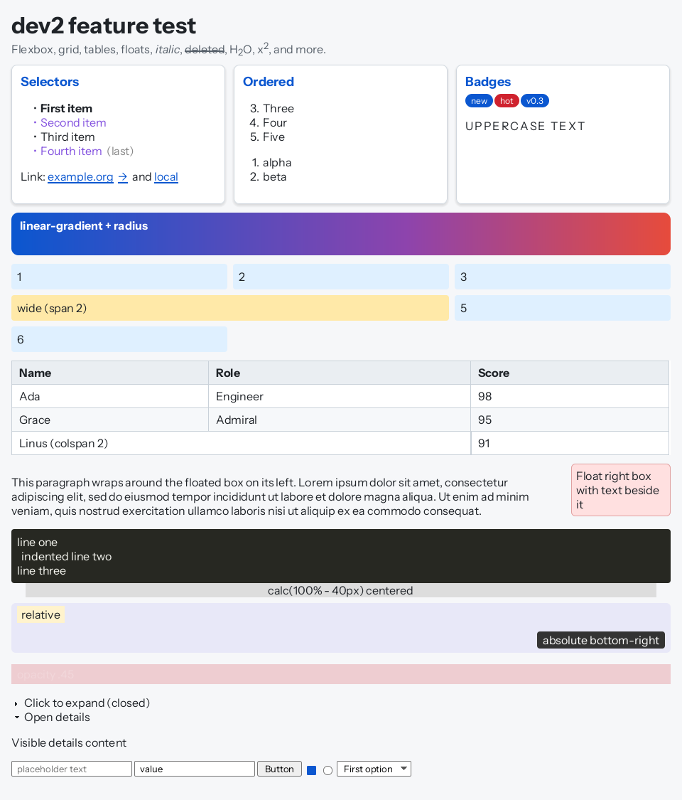
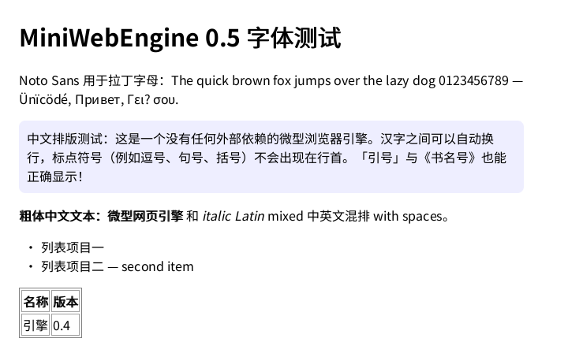

# MiniWebEngine

[](../../actions/workflows/Build.yml)
[](LICENSE)

A small, zero-dependency HTML5 + CSS3 rendering engine written in C99.

**Current version: v0.5** - large HTML5 / CSS3 subset (flexbox, grid, tables, floats, `@media`,
`var()`, `calc()`, gradients, rounded corners, shadows) **plus a JavaScript subset**: an ECMAScript
interpreter with a garbage-collected heap, regular expressions, and DOM bindings (queries, mutation,
events, timers).

MiniWebEngine parses HTML and CSS, runs the cascade, lays the page out, rasterizes it with an
embedded anti-aliased vector font, and either streams a BMP (CLI) or paints into your own pixel
buffer (library). It is built around one goal: stay small and dependency-free.

- **No external dependencies.** The engine source calls no libc function; only the optional CLI uses
  `fopen`/`fread`/`fwrite`/`fclose`. No `malloc` (static arena and a static JS heap), no `libm`.
  (Compilers may still emit `memcpy`/`memmove`/`memset`/`strlen` for struct copies and loops.)
- About 2.7 MB stripped on Linux (`-Os`), 0.4 MB with `-DMWE_NO_CJK`: the CJK font outlines are about 2.4 MB, the Latin/Greek/Cyrillic outlines about 95 KB and the JavaScript engine about 130 KB. Static memory is large (about 70 MB of zero-initialized `.bss`: 16 MB
  document arena + 24 MB JS heap + buffers) but pages are only touched when used
- Library API in `mwe.h`; the same code backs the CLI and [MiniBrowser](browser/README.md)
- Streaming CLI output: the page is rendered in 32-row bands, no full-size framebuffer
- Fuzzed with ASan/UBSan (several thousand mutated pages and scripts, also with a GC-stress build)

> **Naming note:** MiniWebEngine and MiniBrowser are separate from **MiniWeb**, the browser
> built into the MiniWin operating system.

## Build

```sh
# CLI (Linux / MinGW)
cc -std=c99 -Os -s -ffunction-sections -fdata-sections -Wl,--gc-sections mwe.c -o mwe
# macOS
cc -std=c99 -Os -ffunction-sections -fdata-sections -Wl,-dead_strip mwe.c -o mwe && strip mwe
# Library object (see mwe.h)
cc -std=c99 -Os -DMWE_LIB -c mwe.c
```

```sh
./mwe input.html output.bmp [width]      # width 64-2048, default 800
./mwe test2.html out.bmp 960             # the dev2 feature page
```



## Fonts

v0.5 uses the **Noto Sans** family only: every glyph (Latin, Greek, Cyrillic, Simplified Chinese;
Regular + Bold) is an outline of **Noto Sans CJK SC**, embedded in `mwe_font.h`. CJK text wraps
between characters with basic kinsoku rules (closing punctuation never starts a line). The font is
under the SIL Open Font License 1.1 - see [NOTICE.md](NOTICE.md) and [fonts/README.md](fonts/README.md).
`mwe --licenses` / `mwe_licenses()` print the notice. Build with `-DMWE_NO_CJK` for a small
Latin-only binary (about 0.3 MB).



## What is new in v0.5

- **TLS 1.3** in the browser (`browser/tls/`): TLS_AES_128_GCM_SHA256 and TLS_AES_256_GCM_SHA384,
  X25519, HKDF key schedule, CertificateVerify with ECDSA P-256/P-384 and RSA-PSS, Finished,
  KeyUpdate, downgrade protection; TLS 1.2 stays as the fallback. RSA-PSS also works in TLS 1.2
- All fonts are Noto Sans (Inter removed); `tools/regen_font.sh` rebuilds the header
- Not supported: HelloRetryRequest, PSK/resumption/0-RTT, ChaCha20-Poly1305, client certificates

## Library API

```c
#include "mwe.h"
mwe_load(html_buffer, length);          /* parse (buffer is edited in place, must stay valid) */
mwe_viewport_h(600);                    /* optional: viewport height for vh units */
int h = mwe_layout(viewport_width);     /* cascade + layout; returns document height; call again on resize */
mwe_paint(pixels, stride, x, y, w, h);  /* render a document rect as 0x00RRGGBB */
const char *href = mwe_link(x, y, &n);  /* link under a point, or NULL */
mwe_click(x, y);                        /* toggles <details>; returns 1 if you must re-layout */
mwe_stylesheet(i, &n); mwe_add_css(css, n);   /* host-side loading of <link rel=stylesheet> */

/* JavaScript */
mwe_script(i, &n); mwe_add_js(i, text, n);    /* host-side loading of <script src=...> */
mwe_js_time(unix_ms, mono_ms); mwe_js_url(url);
if (mwe_js_run()) { /* scripts changed the page */ }   /* runs all scripts, DOMContentLoaded, load */
int h = mwe_layout(w);                                    /* ...then lay out again */
r = mwe_event_click(x, y);              /* mousedown/mouseup/click; bit0 = re-layout, bit1 = preventDefault() */
mwe_event_key("keydown", "ArrowLeft");  /* key events go to <body> and bubble */
mwe_js_tick(mono_ms);                   /* run due setTimeout/setInterval/requestAnimationFrame callbacks */
mwe_js_log(&n);  mwe_js_alert(&n);  mwe_js_nav(&n);   /* console output, alert() text, location changes */
```
Scripts run once, after the whole document is parsed (like `defer`); `mwe_js_run()` is a no-op for pages
without scripts. The CLI runs the scripts, advances virtual time by one second (so `setTimeout` callbacks
fire), prints `console.log` output to stderr, and then renders.

## Supported (v0.5)

**HTML5** - tags, attributes, comments, implied end tags (`p`, `li`, `dt`/`dd`, `tr`/`td`/`th`,
`thead`/`tbody`/`tfoot`, `option`), void elements, raw-text elements (`style`, `script`, `textarea`),
named (109) and numeric entities, `<title>`, `hidden`. Rendered elements: sectioning and text-level
elements, headings, lists (`ul`/`ol` with `start`/`type`, `dl`), `blockquote`, `pre`, `hr`, `br`/`wbr`,
`mark`, `del`/`ins`/`s`, `sub`/`sup`, `q`, `small`/`big`, tables (`colspan`, `rowspan`, `caption`,
`thead`/`tbody`/`tfoot`), `details`/`summary` (clickable through `mwe_click`), `fieldset`/`legend`,
form controls drawn statically (`input` types, `checkbox`, `radio`, `button`, `select`, `textarea`),
placeholders for `img`/`iframe`/`video`/`canvas` (alt text, no decoding), and presentational attributes
(`bgcolor`, `align`, `valign`, `border`, `cellpadding`, `cellspacing`, `width`, `height`, `font color/size`).

**CSS3 selectors** - type, class, id, `*`, attribute selectors (`=`, `~=`, `|=`, `^=`, `$=`, `*=`),
combinators (descendant, `>`, `+`, `~`), `:first-child`, `:last-child`, `:only-child`, `:nth-child()`,
`:nth-last-child()`, `:nth-of-type()`, `:first-of-type`, `:last-of-type`, `:only-of-type`, `:empty`,
`:root`, `:not()`, `:link`, `:checked`, `:disabled`, `:enabled`, `::before` / `::after` with `content`.
Rules with `:hover`, `:focus`, `:active` and similar cannot apply to a static page and are dropped.

**At-rules and values** - `@media` (width/height/min/max, `screen`/`all`, color-scheme, reduced-motion,
hover/pointer), `@supports` (positive conditions), `@layer` (flattened); `var()` with fallbacks and
custom properties; `calc()`, `min()`, `max()`, `clamp()`; units `px em rem % vw vh vmin vmax ch ex pt pc in cm mm q`;
colors `#rgb #rgba #rrggbb #rrggbbaa rgb() rgba() hsl() hsla()`, all 148 named colors, `transparent`,
`currentcolor`; `!important`; `inherit`; external stylesheets through the host.

**Layout and painting** - block flow with margin collapsing, inline flow with wrapping and baseline
alignment, `inline-block`, **flexbox** (row/column, wrap, grow/shrink/basis, justify-content, align-items,
align-self, gap, order, auto margins), **grid** (fixed / `fr` / auto tracks, `repeat()`, `auto-fill` and
`auto-fit` with `minmax()`, gap, column span, row-major auto-placement), **tables** (auto layout,
spans, border-spacing, approximate border-collapse, vertical-align), `float` / `clear`,
`position: relative | absolute | fixed`, `overflow: hidden`, `box-sizing`, min/max sizes, per-side borders
(solid, dashed, dotted), `border-radius`, `box-shadow` (outer), `linear-gradient()`, `opacity`,
`text-transform`, `letter-spacing`, `white-space`, `line-height`, `vertical-align`, `list-style-type`
(disc, circle, square, decimal, alpha, roman), bold, synthesized italic, underline, line-through.

## JavaScript subset

A tree-walking interpreter (`mwe_js.h`, included by `mwe.c`; about 3,900 lines) with a mark/sweep
garbage collector (precise for heap objects, conservative for the C stack, so it can run in the
middle of a script). Strings are UTF-8; `length`, indexing, `slice` and friends count code points
(an astral character counts as 1, not 2). Numbers print exactly like V8 (shortest round-trip digits,
exact `toFixed`); the regression tests compare against Node.js output.

**Language** - `var`/`let`/`const` with block scoping and per-iteration `let` bindings, hoisting,
functions, arrow functions, default / rest parameters, spread, destructuring (arrays, objects, defaults,
rest, in declarations, parameters, `for...of` and assignments), template literals, classes (`extends`,
`super`, static members, instance fields, getters and setters), object-literal getters / setters,
closures, `this` / `bind` / `call` / `apply`, `new`, `instanceof`, `in`, `delete`, `typeof`, optional
chaining, `??`, logical assignment, `**`, labels, `switch`, `try` / `catch` / `finally`, `for`,
`for...in`, `for...of` (arrays, strings, `Map`, `Set`), comma operator, automatic semicolon insertion.

**Built-ins** - `Object` (keys, values, entries, assign, create, defineProperty incl. accessors, ...),
`Array` (30+ methods incl. `sort`, `flat`, `findLast`), `String` (incl. `padStart`, `replaceAll`, `at`,
`localeCompare` by code point), `Number` (`toFixed`, `toPrecision`, `toExponential`, radix `toString`),
`Math`, `JSON`, `Date` (UTC only), `Map` / `Set` / `WeakMap` / `WeakSet` (linear lookup), `Error` types,
`RegExp`, `console`, `encodeURIComponent` / `decodeURIComponent`, `parseInt` / `parseFloat`,
`structuredClone` (JSON-based), `localStorage` / `sessionStorage` (in memory), `performance.now`.

**Regular expressions** - a backtracking matcher: classes, `\d\w\s\b`, groups (capturing, `(?:)`,
named), alternation, greedy / lazy quantifiers, `{n,m}`, back-references, lookahead, flags `g i m s y`;
`test`, `exec`, `match`, `matchAll`, `replace` (`$1`, `$&`, callbacks), `replaceAll`, `split`, `search`.
Backtracking is capped, so catastrophic patterns fail instead of hanging.

**DOM** - `document` (`getElementById`, `querySelector(All)` using the engine's own selector matcher,
`createElement`, `createTextNode`, `createDocumentFragment`, `title`, `body`, ...), nodes (attributes,
`id`, `className`, `classList`, `style.*` and `cssText`, `dataset`, `value`, `checked`, `innerHTML`,
`outerHTML`, `textContent`, `insertAdjacentHTML`, tree navigation, `append` / `prepend` / `before` /
`after` / `remove` / `replaceWith` / `cloneNode`, `matches` / `closest`, `getBoundingClientRect`,
`offsetWidth` ...), `window` (`innerWidth`, timers, `getComputedStyle` for inline styles, `alert`),
`location` (read, `href =`, `assign`, `reload`), events (`addEventListener`, `on*` properties **and
inline `onclick="..."` attributes**, bubbling, `preventDefault`, `stopPropagation`, `Event`,
`CustomEvent`, `dispatchEvent`), `setTimeout` / `setInterval` / `requestAnimationFrame`. A click that
lands on an unchecked checkbox or radio button toggles it.

**Safety** - a step budget (20 M steps per script, handler or timer callback) aborts runaway loops, the
call depth is limited to 256, and running out of JS heap (24 MB) raises a `RangeError`. Uncaught
errors are reported on the console output instead of stopping the page.

## Limitations

- **JavaScript is a subset**: no `async` / `await`, `Promise`, generators, iterators / `Symbol`,
  modules (`import` / `export`), `Proxy`, typed arrays, `eval`, `with`, lookbehind in regular
  expressions, `fetch` / `XMLHttpRequest`, `Intl`, local-time `Date` (everything is UTC), tagged
  templates, BigInt. Scripts that use them fail to parse and are skipped (a `SyntaxError` is logged).
  `document.write` is a no-op, `<script>` elements created at run time are not executed, and
  `dataset` / `style` are live views of the attributes but not enumerable
- No images or SVG, no `@font-face`, no `@import`
- Latin, Greek, Cyrillic and Simplified Chinese (GB2312) text only: Hangul, Japanese kanji outside GB2312 and Greek with tonos render as `?`; no kerning, no
  monospace face (`pre` and `code` use the proportional font), no bidi / RTL
- No transforms, transitions, animations, filters, `position: sticky`, `text-shadow`, `outline`,
  radial / conic gradients, inset or multiple shadows, grid areas / named lines / subgrid
- `position: fixed` behaves like `absolute` in a static layout
- Capacity limits: 1 MB of HTML in the CLI, 16 MB arena, about 80,000 paint items, 64 flex / grid
  items per container, 16 table columns, 256 cells and 128 rows per table

## MiniBrowser

[`browser/`](browser/README.md) contains **MiniBrowser**, a standalone desktop browser built on this
engine (Win32 + a portable core) with HTTP and verified HTTPS (TLS 1.3 and 1.2). It is **not** MiniWeb.

## Project layout

```
mwe.c, mwe.h            engine (CLI when built without -DMWE_LIB) and its public API
mwe_font.h              generated font data (see fonts/)
mwe_js.h                JavaScript engine (included by mwe.c; not a separate translation unit)
tools/genfont.py        TTF -> mwe_font.h converter (needs fonttools; build-time only)
tests/                  JavaScript regression tests (`sh tests/js/run.sh`) and the jt.c event/timer driver
fonts/                  font licenses and notes
browser/                MiniBrowser (+ browser/tls: TLS 1.3 / 1.2 client and crypto)
test.html, test2.html   sample pages (test2.html exercises the dev2 features; browser/tests/pages/js_demo.html the JS)
.github/workflows/      CI (Linux, Windows, macOS)
```

## License

Copyright (C) MiniWebEngine contributors.

This program is free software: you can redistribute it and/or modify it under the terms of the GNU
General Public License version 3 **only**, as published by the Free Software Foundation. See
[LICENSE](LICENSE) for the full text. This program is distributed in the hope that it will be useful,
but WITHOUT ANY WARRANTY; without even the implied warranty of MERCHANTABILITY or FITNESS FOR A
PARTICULAR PURPOSE.

Embedded font outlines are under the SIL Open Font License 1.1 (see `fonts/`).

SPDX-License-Identifier: `GPL-3.0-only`

Embedded font: Noto Sans CJK SC (Copyright 2014-2021 Adobe; Noto is a trademark of Google Inc.)
under the SIL Open Font License 1.1. See
[NOTICE.md](NOTICE.md); the notices must be kept with any redistribution.
